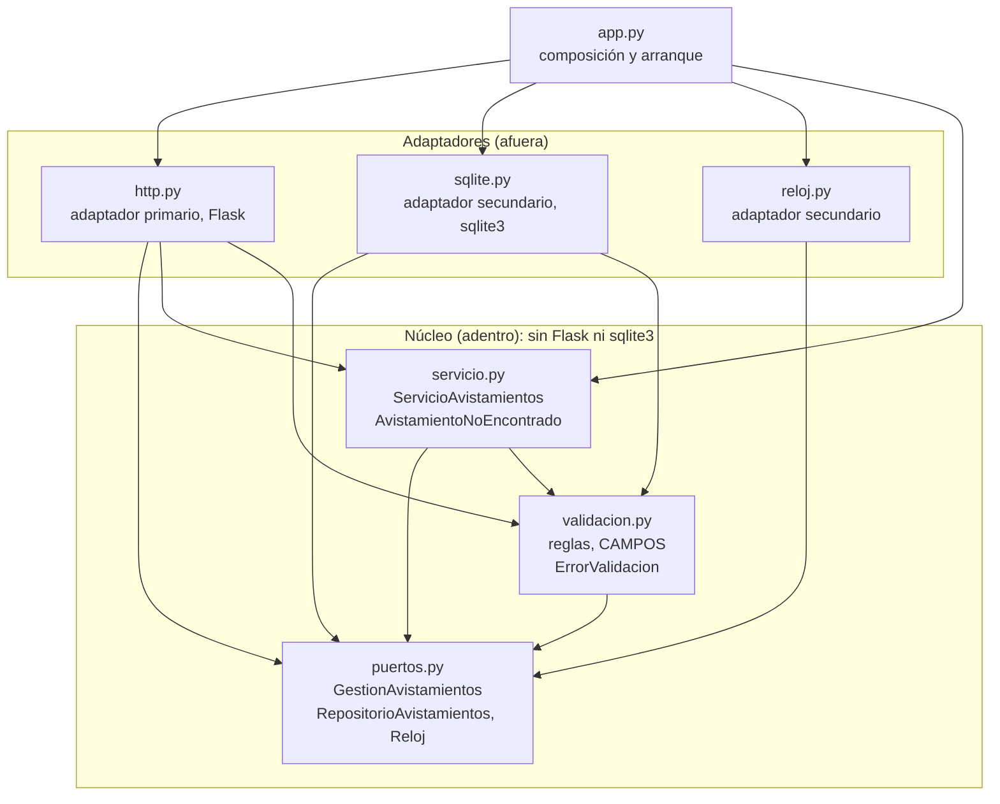

# Taller 5. Clean Architecture y arquitectura hexagonal

**Nicolás Arias Lasprilla**  
Ingeniería de Software 2 · Universidad El Bosque

**Repositorio:** https://github.com/Nicooooal/api-avistamientos  
**Rama:** main  
Documento integrado: investigación y aplicación sobre la API de avistamientos.

## Parte 1. Investigación

### 1. ¿Qué problema identifica Cockburn y cómo funcionan los puertos y adaptadores?

Cockburn parte de un problema: la lógica del negocio se cuela en el código de la interfaz de usuario. Según él, eso tiene tres efectos. El sistema no se puede probar bien con pruebas automáticas, porque parte de la lógica depende de detalles visuales. No se puede pasar de un uso con personas a un uso por lotes. Y cuesta que otro programa maneje la aplicación (Cockburn, 2005). Del otro lado pasa algo parecido: si la lógica queda atada a una base de datos u otro servicio externo, el equipo no puede trabajar cuando ese servidor se cae o se reemplaza (Cockburn, 2005).

Un **puerto** es una conversación con un propósito, y su protocolo toma la forma de una API. Un **adaptador** existe para cada dispositivo externo: convierte esa API en las señales que el dispositivo necesita, y al revés. Un mismo puerto puede tener varios adaptadores. Del lado del usuario caben una interfaz gráfica, un arnés de pruebas o un proceso por lotes; del lado de los datos, una base SQL, un archivo plano o una base simulada en memoria (Cockburn, 2005).

La **simetría** viene de que los dos problemas tienen la misma causa: la lógica del negocio enredada con la interacción con entidades externas. Por eso Cockburn dice que la asimetría que importa no es la de izquierda y derecha, sino la de dentro y fuera de la aplicación, y que lo propio del interior no debe filtrarse al exterior (Cockburn, 2005). Desde la aplicación, la interfaz de usuario y la base de datos son lo mismo: algo externo conectado por un puerto. Más adelante Cockburn distingue, al implementar, puertos primarios (quien dirige la aplicación) y secundarios (los que la aplicación dirige), pero lo presenta como una consecuencia del patrón y no como su idea central (Cockburn, 2005).

En mi API, gestionar avistamientos es un puerto primario y HTTP es su adaptador. Guardar y consultar son operaciones de un puerto secundario, el repositorio, del que SQLite es una implementación; el reloj es otro puerto secundario. Aquí «puerto» no es el número 5000 del servidor, sino el contrato que usa el código.

### 2. ¿Qué contiene cada círculo de Clean Architecture y qué exige la regla de dependencia?

De adentro hacia afuera, Martin (2012) distingue cuatro círculos:

| Círculo | Contenido |
| --- | --- |
| Entidades | Reglas de negocio generales de la empresa, como objetos con métodos o como estructuras de datos y funciones. En una aplicación única, son sus objetos de negocio. |
| Casos de uso | Reglas propias de la aplicación. Orquestan el flujo de datos hacia y desde las entidades. |
| Adaptadores de interfaz | Convierten los datos entre el formato cómodo para casos de uso y entidades y el cómodo para algo externo, como la base de datos o la web. Aquí van los presenters, las vistas y los controllers de MVC, y todo el SQL. |
| Frameworks y drivers | El framework web, la base de datos y otras herramientas. Casi todo el código de este círculo es código de conexión con el círculo interior. |

La **regla de dependencia** dice que las dependencias del código fuente solo pueden apuntar hacia adentro: nada de un círculo interior puede saber algo de un círculo exterior. Prohíbe que el código interior mencione nombres declarados afuera (funciones, clases, variables) y que use formatos de datos de un círculo exterior, sobre todo los que genera un framework (Martin, 2012). Los círculos son esquemáticos: puede haber más de cuatro, pero la regla se aplica siempre (Martin, 2012).

### 3. ¿Cómo guarda datos un caso de uso sin depender de la base?

Martin plantea la contradicción con el caso del controller y el presenter. El flujo de control empieza en el controller, pasa por el caso de uso y termina ejecutándose en el presenter, pero las dependencias del código apuntan hacia adentro, hacia el caso de uso. El caso de uso no puede llamar al presenter de forma directa, porque tendría que nombrar algo de un círculo exterior. La solución es la inversión de dependencias: el caso de uso llama a una interfaz declarada en el círculo interior (el *Use Case Output Port*) y el presenter, afuera, la implementa. Martin dice que la misma técnica sirve para cruzar todas las fronteras (Martin, 2012). Cockburn llega al mismo mecanismo por su lado: cita la inversión de dependencias como la forma de tener adaptadores secundarios intercambiables (Cockburn, 2005).

Guardar datos funciona igual que el presenter. El caso de uso necesita persistir, así que declara una interfaz adentro y la base de datos, afuera, la implementa. En el artículo, además, todo el SQL queda en el círculo de adaptadores y nada hacia adentro sabe de la base (Martin, 2012).

Así quedó en mi API. `ServicioAvistamientos`, en el núcleo, llama a `RepositorioAvistamientos`, una interfaz declarada en `nucleo/puertos.py`. `RepositorioSQLite`, en `adaptadores/sqlite.py`, la implementa y ejecuta el INSERT. `app.py` crea el repositorio SQLite y se lo entrega al servicio al construirlo, así que el servicio no importa SQLite. El flujo de ejecución sale del núcleo hacia SQLite, pero el import apunta hacia adentro: `sqlite.py` importa `puertos.py`, y no al revés. El repositorio devuelve diccionarios y no `sqlite3.Row`, que es lo que Martin pide para los datos que cruzan una frontera: estructuras simples, no filas de la base (Martin, 2012). En las pruebas del núcleo el servicio recibe un repositorio en memoria y hace lo mismo.

### 4. ¿Qué comparten las tres arquitecturas y en qué cambian?

**Qué comparten.** Las tres separan las reglas del negocio de la infraestructura. Martin dice que todas persiguen la separación de responsabilidades dividiendo el software en capas, con al menos una capa para las reglas de negocio y otra para las interfaces (Martin, 2012). Palermo señala que su propuesta y la de Cockburn parten de la misma premisa: externalizar la infraestructura y escribir adaptadores para que no se acople (Palermo, 2008). En las tres, la base de datos es un detalle externo; el núcleo define los contratos y la implementación concreta vive afuera (Cockburn, 2005; Palermo, 2008; Martin, 2012).

**Qué cambia.** Cambian el vocabulario, la figura y, sobre todo, el punto del que parte cada autor:

| | Hexagonal (Cockburn, 2005) | Cebolla (Palermo, 2008) | Clean Architecture (Martin, 2012) |
| --- | --- | --- | --- |
| Figura | Un hexágono con puertos. El seis no importa: la forma deja espacio para dibujar los puertos que haga falta. | Capas concéntricas con el modelo de dominio en el centro. | Cuatro círculos concéntricos, que él mismo llama esquemáticos. |
| Punto de partida | La frontera: dentro y fuera de la aplicación, con pocos puertos (en sus casos, de dos a cuatro). En el artículo no detalla cómo se organiza el interior. | El acoplamiento: todo apunta hacia el centro. El número de capas del núcleo varía. | La dirección de las dependencias, enunciada como una sola regla sobre un diagrama. |
| Vocabulario | Puertos, adaptadores, primarios y secundarios. | Modelo de dominio, interfaces de repositorio, infraestructura. | Entidades, casos de uso, adaptadores de interfaz, frameworks y drivers. |
| Énfasis | Que personas, programas o pruebas puedan manejar la aplicación por igual. | Los objetos y el modelo de dominio; la plantea para aplicaciones duraderas o complejas. | Los casos de uso como capa propia y los datos simples que cruzan las fronteras. |

Mi interpretación es que no cambia solo el nombre ni el número de capas. Cockburn pregunta qué conversaciones tiene la aplicación con el exterior, Palermo pregunta qué debe estar en el centro, y Martin pregunta hacia dónde puede apuntar cada import. Las respuestas son compatibles, y por eso en mi código se pueden reconocer las tres. Palermo ya formula la regla de que todo el acoplamiento va hacia el centro (Palermo, 2008), así que la dirección de las dependencias no es exclusiva de Martin. Lo que Martin agrega es el nombre, la regla única y la capa de casos de uso.

### 5. ¿Se justifica aplicar Clean Architecture a una API pequeña?

Mi posición: **Clean Architecture completa no se justifica para esta API, pero separar HTTP, la regla de validación y el SQL sí**. Palermo dice que la cebolla no es adecuada para sitios pequeños y sí para aplicaciones de negocio duraderas o de comportamiento complejo (Palermo, 2008). Es su arquitectura y no la de Martin, pero la advertencia se aplica por analogía: ambas piden pagar un costo estructural que una API de seis endpoints y una regla de validación no devuelve.

El beneficio concreto es que ahora pruebo el servicio con un repositorio en memoria, sin Flask ni SQLite. `tests/test_nucleo.py` hace el recorrido completo de crear, consultar, actualizar, resumir y borrar así, y una de sus pruebas ejecuta el servicio en un proceso limpio con Flask, Werkzeug y sqlite3 bloqueados. También sé qué archivo tocar según dónde esté el problema: HTTP, una regla o el SQL.

El costo también se puede medir. Antes todo el código de producción estaba en 2 archivos y 138 sentencias; ahora hay 8 archivos con código y 207 sentencias (sección 4 de la Parte 2). Además, el PUT consulta dos veces si el registro existe (sección 6 de la Parte 2).

Por eso elegí una versión sencilla de arquitectura hexagonal y no Clean Architecture completa. No separé entidades de casos de uso porque la API no tiene objetos con comportamiento propio: la regla de negocio es una función de validación, y `ServicioAvistamientos` son seis métodos cortos. Añadir presenters y una capa de entidades multiplicaría los archivos sin dar algo más que comprobar. Si la API creciera, con más reglas, otro cliente además de HTTP u otro almacenamiento, la separación hecha ya permite agregar un adaptador sin tocar el núcleo. Si se queda como está, se paga el costo sin cobrar todo el beneficio. Justifico la separación por lo que permite comprobar y modificar, no por la cantidad de carpetas.

<!-- pagebreak -->

## Parte 2. Aplicación

## 1. Arquitectura elegida y cambios

Elegí **arquitectura hexagonal** (Cockburn, 2005) y usé su vocabulario: núcleo, puertos primario y secundarios, y adaptadores primario y secundarios. «Primario» y «secundario» son los términos de Cockburn, según quién dirige la conversación. No usé los de Clean Architecture (entidades, casos de uso, presenters, *input/output port*). Sobre los dos nombres que podrían parecer de otra arquitectura: «repositorio» aparece en el propio ejemplo de Cockburn, que declara una interfaz `RateRepository` con una versión simulada en memoria (Cockburn, 2005), y `ServicioAvistamientos` cumple el papel de la clase que recibe el repositorio por el constructor, como la aplicación de ese ejemplo.

Apliqué el cambio a **todos los endpoints**: listar, consultar por id, crear, actualizar, eliminar y obtener el resumen por especie. Conservé Flask, SQLite, las rutas, los mensajes y el archivo de datos. Cambió la organización interna, no las operaciones que ofrece la API.

Estructura de carpetas:

```text
api-avistamientos/
├── app.py                       composición: crea Flask y conecta puertos con adaptadores
├── validacion.py                compatibilidad con los imports de las pruebas anteriores
├── avistamientos/
│   ├── nucleo/                  el interior: no importa Flask, Werkzeug ni sqlite3
│   │   ├── puertos.py           GestionAvistamientos (primario); RepositorioAvistamientos y Reloj (secundarios)
│   │   ├── servicio.py          ServicioAvistamientos y AvistamientoNoEncontrado
│   │   └── validacion.py        reglas de negocio, CAMPOS y ErrorValidacion
│   └── adaptadores/             el exterior
│       ├── http.py              adaptador primario (Flask)
│       ├── sqlite.py            adaptador secundario (sqlite3)
│       └── reloj.py             adaptador secundario (reloj del sistema)
├── tests/
│   ├── conftest.py              reloj fijo y fixtures
│   ├── test_api.py              51 pruebas de integración (anteriores, sin cambios)
│   ├── test_validacion.py       58 pruebas unitarias (anteriores, sin cambios)
│   └── test_nucleo.py           3 pruebas nuevas del núcleo
├── scripts/comparar_api.py      compara las respuestas de dos versiones de la API
├── docs/                        justificación de pruebas e informe de este taller
├── ejemplos/                    cuerpos JSON del README
└── requirements.txt, requirements-dev.txt, pytest.ini, README.md
```

| Ubicación | Responsabilidad |
| --- | --- |
| `app.py` | Crear Flask, configurar la base, conectar los objetos y cerrar cada conexión. También conserva el arranque por consola. |
| `avistamientos/nucleo/puertos.py` | Definir `GestionAvistamientos` como puerto primario, y `RepositorioAvistamientos` y `Reloj` como puertos secundarios. |
| `avistamientos/nucleo/servicio.py` | Implementar las operaciones y coordinar la validación con el repositorio recibido. |
| `avistamientos/nucleo/validacion.py` | Conservar las reglas de especie, fecha y campos obligatorios. |
| `avistamientos/adaptadores/http.py` | Traducir peticiones a llamadas al núcleo y resultados o errores a respuestas HTTP. |
| `avistamientos/adaptadores/sqlite.py` | Implementar persistencia, consultas SQL y conversión de filas a diccionarios. |
| `avistamientos/adaptadores/reloj.py` | Implementar el reloj del sistema. |
| `validacion.py` | Reexportar los nombres anteriores para que las pruebas existentes sigan funcionando; no duplica reglas. |
| `scripts/comparar_api.py` | Ejecutar una secuencia fija de peticiones contra una versión de la API (sección 5). |

<!-- pagebreak -->

## 2. Dirección de las dependencias

Cada flecha significa «importa a» y muestra dependencias del código, no el orden de una petición. El diagrama sale de los imports reales de cada módulo.



Todas las flechas entre los dos grupos van de afuera hacia adentro; el núcleo no importa a ningún adaptador ni a `app.py`. Lo comprobé de dos maneras. La primera es leer los imports de cada módulo con el módulo `ast` de Python:

| Módulo | Importa (sin contar la biblioteca estándar) |
| --- | --- |
| `nucleo/puertos.py` | nada |
| `nucleo/validacion.py` | `puertos` |
| `nucleo/servicio.py` | `puertos`, `validacion` |
| `adaptadores/http.py` | `puertos`, `servicio`, `validacion` del núcleo; Flask y Werkzeug |
| `adaptadores/sqlite.py` | `puertos`, `validacion` del núcleo |
| `adaptadores/reloj.py` | `puertos` del núcleo |
| `app.py` | los tres adaptadores y `servicio`; Flask |

La segunda es la prueba `test_nucleo_se_ejecuta_con_imports_externos_bloqueados`, que ejecuta el servicio en un proceso limpio con Flask, Werkzeug, sqlite3 y los adaptadores bloqueados.

El adaptador HTTP usa el puerto `GestionAvistamientos` y, para traducir los errores a 400 o 404, importa también `ErrorValidacion` y `AvistamientoNoEncontrado`. SQLite implementa `RepositorioAvistamientos` y usa la lista de campos del núcleo. El reloj del sistema implementa `Reloj`. El `validacion.py` de la raíz no aparece en el diagrama: solo reexporta nombres para las pruebas anteriores.

Un límite que conviene decir: `AvistamientoNoEncontrado` está declarada en `servicio.py`, así que el adaptador HTTP importa ese módulo del núcleo y no solo los puertos. No viola la regla, porque la dependencia apunta hacia adentro, pero lo más limpio sería ponerla en un módulo propio de errores.

Por ejemplo, al crear un registro, HTTP lee el JSON y llama a `crear`. El servicio valida y pide guardar al repositorio que recibió. En ejecución ese objeto es `RepositorioSQLite`, pero el servicio no importa esa clase. La respuesta cruza el límite como un diccionario normal, sin objetos de Flask ni `sqlite3.Row`.

### Evolución en el mismo repositorio

Los cambios se hicieron en pasos comprobados dentro del mismo repositorio, sin crear otro:

1. [ccfd4af](https://github.com/Nicooooal/api-avistamientos/commit/ccfd4af290584f8344c3b1276615dbc02b4dcdf8): separar la validación y el reloj del framework. Las 109 pruebas siguen pasando.
2. [84ca66b](https://github.com/Nicooooal/api-avistamientos/commit/84ca66bb717aba31a56fd7a3da30ded6f7c1c27a): definir los puertos y el servicio, añadir el adaptador SQLite y tres pruebas nuevas. Aquí todavía se conserva la conexión HTTP anterior.
3. [3290c11](https://github.com/Nicooooal/api-avistamientos/commit/3290c11aa38f21f1b218b91805ba3c1ef937602c): conectar todos los endpoints al servicio y dejar `app.py` como composición y arranque.
4. [892cc4a](https://github.com/Nicooooal/api-avistamientos/commit/892cc4ad96d00f995dcd68030fe873d7ae341952): documentar la Parte 2 con el diagrama y las evidencias.
5. [e473725](https://github.com/Nicooooal/api-avistamientos/commit/e4737253eac08b5ceebe1b77ec16d8de3c297d38): actualizar la descripción del README.
6. [efc7491](https://github.com/Nicooooal/api-avistamientos/commit/efc749171185f07f5315eecd01c13de0fe8ab700): integrar la investigación de la Parte 1 en el informe.
7. La revisión final se publicó en varios commits, no en uno solo: se ajustaron los docstrings y el nombre de una prueba a la terminología hexagonal, se actualizó el README, se corrigió la Parte 1 y se añadieron el comparador `scripts/comparar_api.py` y las evidencias reproducibles. Estos cambios figuran en el historial de GitHub, desde [c5bf9b9](https://github.com/Nicooooal/api-avistamientos/commit/c5bf9b9c79aa564098bb0fb51935c36198bddd83) hasta [9875cc8](https://github.com/Nicooooal/api-avistamientos/commit/9875cc87b4efd0eaa79bc907a645cecd939801dd).

### Comprobaciones añadidas

Añadí un recorrido de creación, consulta, actualización, resumen y borrado con un repositorio en memoria; una comprobación de que los datos inválidos no llegan al repositorio; y una ejecución en un proceso limpio que bloquea las importaciones externas, con la que verifico que el núcleo funciona sin Flask ni SQLite. El repositorio en memoria es un **fake de pruebas**, no una nueva opción de almacenamiento para el usuario.

<!-- pagebreak -->

## 3. Evidencia antes del refactor

Tomé como punto de partida el commit [e1c4a37](https://github.com/Nicooooal/api-avistamientos/commit/e1c4a37802ca52fee0be60714ae0886645cc0293). Las pruebas pasaron antes de reorganizar el código; no hubo que corregir ningún fallo previo.

Todas las ejecuciones de este informe se hicieron en un entorno Linux con Python 3.12.3, Flask 3.1.3, pytest 9.1.1, pytest-cov 7.1.0 y coverage 7.16.2, las versiones fijadas en `requirements*.txt`. No las hice en mi equipo Windows; la sección 7 trae los comandos para repetirlas allí. Las salidas se pegan sin editar. El apoyo de IA que usé está declarado en el README.

Para ejecutar el «antes» sin perder la versión actual, se crea una carpeta de trabajo separada desde el mismo repositorio:

```bash
git worktree add --detach ../avistamientos-antes e1c4a37802ca52fee0be60714ae0886645cc0293
cd ../avistamientos-antes
python -m pytest --cov=app --cov=validacion --cov-branch --cov-report=term-missing
```

```text
============================= test session starts ==============================
platform linux -- Python 3.12.3, pytest-9.1.1, pluggy-1.7.0
rootdir: /home/claude/antes
configfile: pytest.ini
testpaths: tests
plugins: cov-7.1.0
collected 109 items

tests/test_api.py ...................................................    [ 46%]
tests/test_validacion.py ............................................... [ 89%]
...........                                                              [100%]

================================ tests coverage ================================
_______________ coverage: platform linux, python 3.12.3-final-0 ________________

Name            Stmts   Miss Branch BrPart  Cover   Missing
-----------------------------------------------------------
app.py            102      6     22      3    93%   53->55, 89, 145, 165-168
validacion.py      36      1     16      0    98%   17
-----------------------------------------------------------
TOTAL             138      7     38      3    94%
============================= 109 passed in 0.99s ==============================
```

El resultado: **109 pruebas aprobadas y 94 % de cobertura combinada de sentencias y ramas**. En esta versión todo el código de producción medido estaba en `app.py` y `validacion.py`.

<!-- pagebreak -->

## 4. Evidencia después del refactor

Primero ejecuté **las mismas 109 pruebas**, sin modificar `tests/test_api.py`, `tests/test_validacion.py` ni `tests/conftest.py`. Añadí `--cov=avistamientos` para que la medición incluya los módulos que ahora contienen la implementación; medir solo los dos archivos anteriores habría dejado fuera casi todo el código.

```bash
python -m pytest tests/test_api.py tests/test_validacion.py --cov=app --cov=validacion --cov=avistamientos --cov-branch --cov-report=term-missing
```

```text
============================= test session starts ==============================
platform linux -- Python 3.12.3, pytest-9.1.1, pluggy-1.7.0
rootdir: /home/claude/api-avistamientos
configfile: pytest.ini
plugins: cov-7.1.0
collected 109 items

tests/test_api.py ...................................................    [ 46%]
tests/test_validacion.py ............................................... [ 89%]
...........                                                              [100%]

================================ tests coverage ================================
_______________ coverage: platform linux, python 3.12.3-final-0 ________________

Name                                    Stmts   Miss Branch BrPart  Cover   Missing
-----------------------------------------------------------------------------------
app.py                                     31      4      8      3    82%   20->22, 28->30, 43-46
avistamientos/__init__.py                   0      0      0      0   100%
avistamientos/adaptadores/__init__.py       0      0      0      0   100%
avistamientos/adaptadores/http.py          53      1      2      0    98%   36
avistamientos/adaptadores/reloj.py          5      1      0      0    80%   8
avistamientos/adaptadores/sqlite.py        46      1      6      1    96%   69
avistamientos/nucleo/__init__.py            0      0      0      0   100%
avistamientos/nucleo/puertos.py             6      0      0      0   100%
avistamientos/nucleo/servicio.py           31      1      6      1    95%   36
avistamientos/nucleo/validacion.py         31      0     16      0   100%
validacion.py                               4      0      0      0   100%
-----------------------------------------------------------------------------------
TOTAL                                     207      8     38      5    95%
============================= 109 passed in 1.06s ==============================
```

Después ejecuté la suite completa, con las tres comprobaciones nuevas, y su reporte de cobertura:

```bash
python -m pytest --cov=app --cov=validacion --cov=avistamientos --cov-branch --cov-report=term-missing
```

```text
============================= test session starts ==============================
platform linux -- Python 3.12.3, pytest-9.1.1, pluggy-1.7.0
rootdir: /home/claude/api-avistamientos
configfile: pytest.ini
testpaths: tests
plugins: cov-7.1.0
collected 112 items

tests/test_api.py ...................................................    [ 45%]
tests/test_nucleo.py ...                                                 [ 48%]
tests/test_validacion.py ............................................... [ 90%]
...........                                                              [100%]

================================ tests coverage ================================
_______________ coverage: platform linux, python 3.12.3-final-0 ________________

Name                                    Stmts   Miss Branch BrPart  Cover   Missing
-----------------------------------------------------------------------------------
app.py                                     31      4      8      3    82%   20->22, 28->30, 43-46
avistamientos/__init__.py                   0      0      0      0   100%
avistamientos/adaptadores/__init__.py       0      0      0      0   100%
avistamientos/adaptadores/http.py          53      1      2      0    98%   36
avistamientos/adaptadores/reloj.py          5      1      0      0    80%   8
avistamientos/adaptadores/sqlite.py        46      1      6      1    96%   69
avistamientos/nucleo/__init__.py            0      0      0      0   100%
avistamientos/nucleo/puertos.py             6      0      0      0   100%
avistamientos/nucleo/servicio.py           31      1      6      1    95%   36
avistamientos/nucleo/validacion.py         31      0     16      0   100%
validacion.py                               4      0      0      0   100%
-----------------------------------------------------------------------------------
TOTAL                                     207      8     38      5    95%
============================= 112 passed in 0.99s ==============================
```

La suite completa da el mismo total que las 109 pruebas: **207 sentencias, 8 sin ejecutar, 38 ramas, 5 parcialmente cubiertas y 95 % combinado**. Las tres pruebas nuevas no cubren líneas que las anteriores no cubrieran; aportan otra cosa: comprueban el núcleo sin Flask ni SQLite. Que la cobertura suba de 94 % a 95 % no demuestra una mejora, porque al separar responsabilidades también cambió el número de sentencias (de 138 a 207).

La línea 17 de `validacion.py`, que no se cubría antes, es `return date.today()` del reloj real. Ahora es `adaptadores/reloj.py:8` y sigue sin cubrirse. El refactor movió esa línea; no cambió su cobertura.

Lo que sigue sin cubrirse, por archivo:

| Línea | Qué es |
| --- | --- |
| `app.py` 20→22 | Rama en que `create_app` se llama sin configuración de prueba. |
| `app.py` 28→30 | Rama en que la conexión ya existe en la misma petición. |
| `app.py` 43-46 | Arranque por consola. |
| `adaptadores/http.py` 36 | Manejo genérico del error 500. |
| `adaptadores/reloj.py` 8 | Reloj real del sistema. |
| `adaptadores/sqlite.py` 69 | UPDATE que no modifica filas porque el registro desapareció. |
| `nucleo/servicio.py` 36 | El mismo caso, visto desde el servicio. |

El núcleo de validación alcanza el 100 %, pero eso tampoco garantiza que no tenga defectos.

<!-- pagebreak -->

## 5. Muestra de que la API responde igual

Escribí `scripts/comparar_api.py`, que ejecuta 26 peticiones fijas contra una versión de la API con un reloj fijo (2026-10-21) y una base temporal nueva. Para cada una registra código HTTP, `Content-Type`, `Location`, `Allow` y el cuerpo. Lo ejecuté sobre el commit `e1c4a37` y sobre la versión actual, y comparé las salidas con `diff`: **0 diferencias en las 26 peticiones**.

```bash
python scripts/comparar_api.py ../avistamientos-antes > antes.txt
python scripts/comparar_api.py .                      > despues.txt
diff antes.txt despues.txt && echo "idénticas"
```

La tabla muestra lo que devolvieron las dos versiones, que coincide en todas las filas:

| # | Petición | Estado | Cuerpo |
| --- | --- | --- | --- |
| 1 | `GET /avistamientos`, lista vacía | 200 | `[]` |
| 2 | `POST /avistamientos`, datos válidos | 201 (Location `/avistamientos/1`) | `{"id":1,"especie":"colibrí","lugar":"Bogotá","fecha":"2026-10-21","observad...` |
| 3 | `GET /avistamientos/1`, por id | 200 | `{"id":1,"especie":"colibrí","lugar":"Bogotá","fecha":"2026-10-21","observad...` |
| 4 | `PUT /avistamientos/1`, reemplazo válido | 200 | `{"id":1,"especie":"colibrí","lugar":"Humedal Santa María del Lago","fecha":...` |
| 5 | `GET /avistamientos/resumen`, resumen | 200 | `[{"especie":"colibrí","cantidad":1}]` |
| 6 | `PUT /avistamientos/1`, especie corta (400) | 400 | `{"error": "El campo 'especie' debe tener entre 3 y 50 caracteres."}` |
| 7 | `PUT /avistamientos/99`, id inexistente + JSON roto (404) | 404 | `{"error":"Avistamiento no encontrado."}` |
| 8 | `PUT /avistamientos/1`, id existente + JSON roto (400) | 400 | `{"error": "The browser (or proxy) sent a request that this server could not...` |
| 9 | `POST /avistamientos`, sin Content-Type JSON (400) | 400 | `{"error": "Envía el cuerpo con Content-Type: application/json."}` |
| 10 | `POST /avistamientos`, campos faltantes (400) | 400 | `{"error": "Faltan campos obligatorios: lugar, fecha, observador."}` |
| 11 | `POST /avistamientos`, campo extra (400) | 400 | `{"error": "Campos no permitidos: id. El id lo asigna el sistema."}` |
| 12 | `POST /avistamientos`, fecha imposible (400) | 400 | `{"error": "El campo 'fecha' debe ser una fecha real del calendario."}` |
| 13 | `POST /avistamientos`, fecha futura (400) | 400 | `{"error": "El campo 'fecha' no puede ser posterior a hoy."}` |
| 14 | `POST /avistamientos`, tipo incorrecto (400) | 400 | `{"error": "El campo 'lugar' debe ser texto no vacío."}` |
| 15 | `POST /avistamientos`, cuerpo no objeto (400) | 400 | `{"error": "El cuerpo debe ser un objeto JSON."}` |
| 16 | `POST /avistamientos`, cuerpo excesivo (413) | 413 | `{"error": "The data value transmitted exceeds the capacity limit."}` |
| 17 | `GET /avistamientos`, lista con un registro | 200 | `[{"id":1,"especie":"colibrí","lugar":"Humedal Santa María del Lago","fecha"...` |
| 18 | `PATCH /avistamientos/1`, no implementado (405) | 405 (Allow `DELETE, GET, HEAD, OPTIONS, PUT`) | `{"error": "The method is not allowed for the requested URL."}` |
| 19 | `DELETE /avistamientos`, colección (405) | 405 (Allow `GET, HEAD, OPTIONS, POST`) | `{"error": "The method is not allowed for the requested URL."}` |
| 20 | `GET /nada`, ruta inexistente (404) | 404 | `{"error": "The requested URL was not found on the server. If you entered th...` |
| 21 | `GET /avistamientos/abc`, id no numérico (404) | 404 | `{"error": "The requested URL was not found on the server. If you entered th...` |
| 22 | `DELETE /avistamientos/1`, existente | 200 | `{"mensaje":"Avistamiento eliminado.","id":1}` |
| 23 | `GET /avistamientos/1`, tras borrar (404) | 404 | `{"error":"Avistamiento no encontrado."}` |
| 24 | `DELETE /avistamientos/1`, repetido (404) | 404 | `{"error":"Avistamiento no encontrado."}` |
| 25 | `PUT /avistamientos/1`, tras borrar (404) | 404 | `{"error":"Avistamiento no encontrado."}` |
| 26 | `GET /avistamientos/resumen`, resumen vacío | 200 | `[]` |

La comparación cubre CRUD, resumen, datos inválidos, cuerpos mal formados o excesivos, y errores 404 y 405. No implica haber probado todas las peticiones posibles, y usa el cliente de pruebas de Flask, sin red. Por eso repetí tres peticiones contra el servidor real, con `python app.py --port 5055` y `curl`, en las dos versiones. La salida fue idéntica en ambas:

```text
$ curl -i http://127.0.0.1:5055/avistamientos
HTTP/1.1 200 OK
Content-Type: application/json
Content-Length: 3

[]

$ curl -i -X POST http://127.0.0.1:5055/avistamientos -H "Content-Type: application/json" --data-binary @ejemplos/crear.json
HTTP/1.1 201 CREATED
Content-Type: application/json
Content-Length: 114
Location: /avistamientos/1

{"id":1,"especie":"colibrí","lugar":"Jardín Botánico de Bogotá","fecha":"2026-09-29","observador":"Nicolás"}

$ curl -i http://127.0.0.1:5055/avistamientos/1
HTTP/1.1 200 OK
Content-Type: application/json
Content-Length: 114

{"id":1,"especie":"colibrí","lugar":"Jardín Botánico de Bogotá","fecha":"2026-09-29","observador":"Nicolás"}
```

## 6. Qué fue lo más difícil de separar

Lo más delicado fue conservar el comportamiento de PUT mientras separaba HTTP, validación y persistencia. Antes se consultaba si existía el id **antes de leer el cuerpo**. Si movía toda la lectura al principio, un id inexistente con JSON mal formado habría pasado de responder 404 a responder 400. La comparación lo vigila con dos peticiones: un PUT con id inexistente y JSON roto responde 404, y con id existente y JSON roto responde 400.

Por eso el adaptador HTTP consulta primero mediante el servicio y después lee el JSON. El servicio vuelve a comprobar la existencia al actualizar, para que la operación también sea válida cuando la invoque otro adaptador. Esa consulta repetida es un costo concreto de esta solución sencilla, y no protege por sí sola contra todas las carreras concurrentes.

También separé el manejo de conexiones de las reglas. SQLite conserva el SQL y el rango válido de ids (hasta 2^63 − 1); `app.py` se encarga de abrir la conexión por contexto y de cerrarla. Así el núcleo puede trabajar con un repositorio en memoria, mientras las pruebas de integración siguen usando SQLite real. El costo es tener más archivos y contratos para una API pequeña.

## 7. Cómo reproducir la evidencia

Desde la carpeta del proyecto, con el entorno virtual creado según el README (en Windows, `.\.venv\Scripts\python.exe` en lugar de `python`, y `curl.exe` en lugar de `curl`):

```bash
python -m pip install -r requirements-dev.txt
python -m pytest -v
python -m pytest --cov=app --cov=validacion --cov=avistamientos --cov-branch --cov-report=term-missing
python scripts/comparar_api.py .
```

Se esperan **112 pruebas aprobadas**: las 109 anteriores más las tres nuevas. El «antes» se reproduce con el `git worktree` de la sección 3. El refactor no borra la base existente.

## Referencias

Cockburn, A. (2005). *Hexagonal architecture*. Secciones Intent, Motivation y Nature of the Solution, y las notas de aplicación sobre puertos primarios y secundarios. https://alistair.cockburn.us/hexagonal-architecture/

Martin, R. C. (2012, 13 de agosto). *The Clean Architecture*. The Clean Code Blog. https://blog.cleancoder.com/uncle-bob/2012/08/13/the-clean-architecture.html

Palermo, J. (2008, 29 de julio). *The Onion Architecture: part 1*. Programming with Palermo. https://jeffreypalermo.com/2008/07/the-onion-architecture-part-1/

Las respuestas de investigación son una síntesis de estas fuentes, contrastadas con los textos originales. Los ejemplos sobre avistamientos, los resultados de pruebas y las decisiones de implementación corresponden al proyecto del repositorio. El apoyo de ChatGPT/Codex y, en la revisión final de este informe, de Claude (Anthropic) está declarado en el README.
