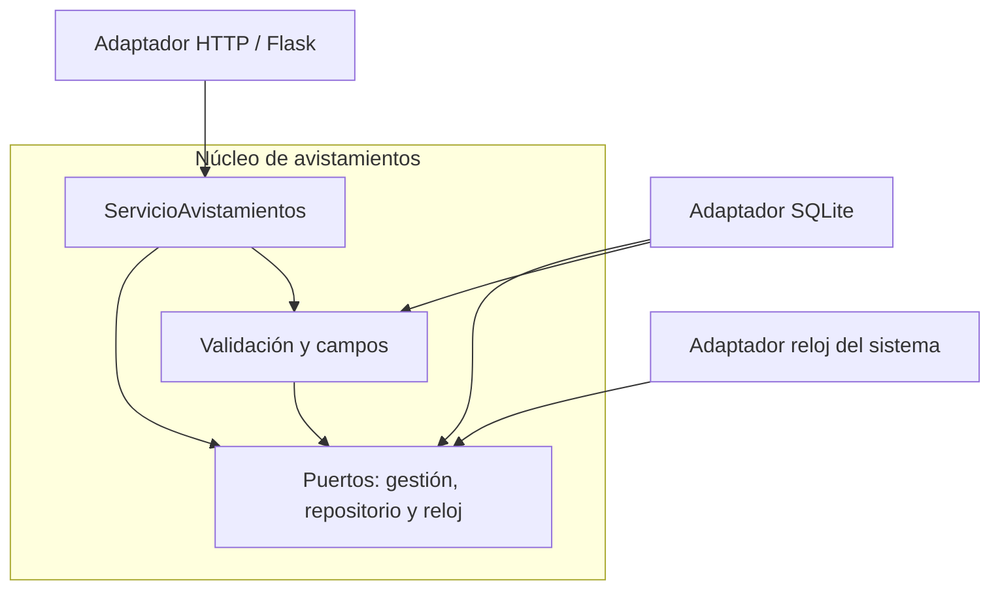

# Taller 5. Clean Architecture y arquitectura hexagonal

**Nicolás Arias Lasprilla**  
Ingeniería de Software 2 · Universidad El Bosque

**Repositorio:** https://github.com/Nicooooal/api-avistamientos  
**Rama:** main  
Documento integrado: investigación y aplicación sobre la API de avistamientos.

## Parte 1. Investigación

### 1. ¿Qué problema identifica Cockburn y cómo funcionan los puertos y adaptadores?

Cockburn identifica que la lógica del negocio termina mezclada con la interfaz o atada a la base de datos. Esto dificulta automatizar pruebas, ejecutar procesos por lotes y trabajar cuando la base no está disponible (Cockburn, 2005).

Un **puerto** define una conversación que la aplicación necesita ofrecer o utilizar. Un **adaptador** traduce esa conversación a una tecnología concreta. La simetría consiste en que tanto el usuario como la base son externos: en ambos lados hay que separar la interacción técnica de las reglas internas (Cockburn, 2005).

En mi API, gestionar avistamientos es el puerto de entrada y HTTP es su adaptador. Guardar y consultar son operaciones del puerto de repositorio; SQLite es una implementación. Aquí “puerto” no significa el número 5000 del servidor, sino el contrato que usa el código.

### 2. ¿Qué contiene cada círculo de Clean Architecture y qué exige la regla de dependencia?

De adentro hacia afuera, Martin (2012) distingue:

| Círculo | Contenido |
| --- | --- |
| Entidades | Reglas generales del negocio, expresadas mediante objetos o datos y funciones. |
| Casos de uso | Operaciones específicas de la aplicación que coordinan esas reglas. |
| Adaptadores de interfaz | Conversión entre los datos internos y los formatos de presentación o persistencia. |
| Frameworks y controladores técnicos | Herramientas externas, como el framework web y la base de datos. |

La **regla de dependencia** exige que el código dependa hacia adentro. Prohíbe que una parte interna conozca nombres o formatos definidos afuera. No obliga a tener exactamente cuatro círculos (Martin, 2012).

### 3. ¿Cómo guarda datos un caso de uso sin depender de la base?

La solución es definir una interfaz dentro y hacer que la implementación externa la cumpla. Al ejecutar, se proporciona esa implementación al caso de uso. El flujo de ejecución puede salir, aunque la dependencia del código apunte hacia dentro: es inversión de dependencias (Martin, 2012).

En mi implementación, `ServicioAvistamientos` recibe un `RepositorioAvistamientos`. Al crear, valida y llama a `repositorio.crear(datos)`. `app.py` le entrega un `RepositorioSQLite`, que ejecuta el INSERT. El servicio no importa SQLite. En una prueba recibe un repositorio en memoria y realiza la misma operación. Este ejemplo aplica el mecanismo descrito por Martin; la organización elegida para mi proyecto sigue siendo hexagonal.

<!-- pagebreak -->

### 4. ¿Qué comparten las tres arquitecturas y en qué cambian?

Las tres buscan separar las reglas de las tecnologías externas. La base de datos queda como un detalle reemplazable y las interfaces permiten conectar implementaciones sin poner ese conocimiento en el centro (Cockburn, 2005; Palermo, 2008; Martin, 2012).

| Arquitectura | Enfoque que la distingue |
| --- | --- |
| Hexagonal | Organiza la frontera mediante puertos y adaptadores; no exige seis componentes (Cockburn, 2005). |
| Cebolla | Sitúa el modelo de dominio en el centro, rodeado de contratos y comportamiento. El número de capas puede variar; la infraestructura queda afuera (Palermo, 2008). |
| Clean Architecture | Distingue entidades, casos de uso, adaptadores y herramientas externas (Martin, 2012). |

No cambia solo el nombre. Palermo da especial importancia al modelo de dominio y a los objetos, mientras Cockburn destaca las conversaciones entre la aplicación y el exterior (Palermo, 2008; Cockburn, 2005). Mi interpretación es que comparten un objetivo, pero ofrecen formas distintas de decidir y explicar los límites del código.

### 5. ¿Se justifica aplicar Clean Architecture a una API pequeña?

Mi posición es que **sí vale la pena separar las reglas de las tecnologías, pero no añadiría todas las capas de Clean Architecture solo para completar un esquema**. Palermo orienta su propuesta a aplicaciones de negocio duraderas o complejas y advierte que no es adecuada para sitios pequeños; tomo esa advertencia como motivo para evaluar el costo, no como una prohibición de separar responsabilidades (Palermo, 2008).

En esta API veo un beneficio concreto: ahora puedo probar la creación de avistamientos con un repositorio en memoria, sin Flask ni SQLite. También puedo identificar qué archivo debo cambiar si el problema está en HTTP, en una regla o en el SQL. El costo es que una operación corta queda distribuida entre más archivos y debo mantener contratos y configurar sus implementaciones.

Por eso elegí una versión sencilla de arquitectura hexagonal para la Parte 2. Me permite practicar esa separación con el mismo código que ya tenía. Si la API se quedara como un ejercicio pequeño y sin cambios, no asumiría que agregar más capas mejoraría el proyecto. Justifico la separación por lo que permite comprobar y modificar, no por la cantidad de carpetas.

<!-- pagebreak -->

## Parte 2. Aplicación

## 1. Arquitectura elegida y cambios

Para reorganizar la API elegí **arquitectura hexagonal**, usando los nombres núcleo, puertos y adaptadores. La idea que apliqué fue mantener las reglas dentro de la aplicación y conectar las tecnologías externas mediante adaptadores, como propone Cockburn (2005).

Apliqué el cambio a **todos los endpoints**: listar, consultar por id, crear, actualizar, eliminar y obtener el resumen por especie. Conservé Flask, SQLite, las rutas, los mensajes y el archivo de datos. Cambió la organización interna, no las operaciones que ofrece la API.

| Ubicación | Responsabilidad |
| --- | --- |
| `app.py` | Crear Flask, configurar la base, conectar los objetos y cerrar cada conexión. También conserva el arranque por consola. |
| `avistamientos/nucleo/puertos.py` | Definir `GestionAvistamientos` como puerto de entrada y `RepositorioAvistamientos` y `Reloj` como puertos de salida. |
| `avistamientos/nucleo/servicio.py` | Implementar las operaciones y coordinar la validación con el repositorio recibido. |
| `avistamientos/nucleo/validacion.py` | Conservar las reglas de especie, fecha y campos obligatorios. |
| `avistamientos/adaptadores/http.py` | Traducir peticiones a llamadas al núcleo y resultados o errores a respuestas HTTP. |
| `avistamientos/adaptadores/sqlite.py` | Implementar persistencia, consultas SQL y conversión de filas a diccionarios. |
| `avistamientos/adaptadores/reloj.py` | Implementar el reloj del sistema. |
| `validacion.py` | Reexportar los nombres anteriores para mantener compatibles las pruebas existentes; no duplica reglas. |
| `tests/` | Conservar las 109 pruebas anteriores y añadir tres comprobaciones del núcleo. |
| `docs/` | Mantener la justificación del taller anterior y este informe del Taller 5. |

Dentro de `avistamientos/`, las carpetas `nucleo/` y `adaptadores/` son paquetes de Python y tienen su `__init__.py`. También se mantienen los archivos de dependencias, `pytest.ini`, `.gitignore` y los ejemplos JSON del README.

<!-- pagebreak -->

## 2. Dirección de las dependencias

Las flechas del diagrama muestran **dependencias del código**, no el orden de una petición. El núcleo no importa Flask, Werkzeug, sqlite3 ni los adaptadores. `app.py` está fuera del núcleo y conoce las implementaciones para conectarlas.



El adaptador HTTP utiliza el puerto `GestionAvistamientos`; también conoce los errores del núcleo para traducirlos a 400 o 404. SQLite implementa `RepositorioAvistamientos` y usa la lista de campos del núcleo. El reloj del sistema implementa `Reloj`. Ninguna dependencia vuelve desde el núcleo hacia esos adaptadores.

Por ejemplo, al crear un registro, HTTP lee el JSON y llama a `crear`. El servicio valida y pide guardar al repositorio que recibió. En ejecución ese objeto es `RepositorioSQLite`, pero el servicio no importa esa clase. La respuesta cruza el límite como un diccionario normal, sin objetos de Flask ni `sqlite3.Row`.

### Evolución en el mismo repositorio

Los cambios se dividieron en pasos comprobados, sin crear otro repositorio:

1. [ccfd4af](https://github.com/Nicooooal/api-avistamientos/commit/ccfd4af290584f8344c3b1276615dbc02b4dcdf8): mover validación y reloj; las 109 pruebas siguen pasando.
2. [84ca66b](https://github.com/Nicooooal/api-avistamientos/commit/84ca66bb717aba31a56fd7a3da30ded6f7c1c27a): incorporar puertos, servicio, adaptador SQLite y tres pruebas nuevas. En este paso todavía se conserva la conexión HTTP anterior.
3. [3290c11](https://github.com/Nicooooal/api-avistamientos/commit/3290c11aa38f21f1b218b91805ba3c1ef937602c): conectar todos los endpoints al servicio y dejar `app.py` como composición y arranque.
4. Un commit posterior incorpora este informe y actualiza los comandos del README.

### Comprobaciones añadidas

Añadí un recorrido de creación, consulta, actualización, resumen y borrado con un repositorio en memoria; una comprobación de que los datos inválidos no se guardan; y una ejecución en un proceso limpio que bloquea las importaciones externas. Esta última permite comprobar que el núcleo realmente funciona sin Flask ni SQLite. El repositorio en memoria es un **fake de pruebas**, no una nueva opción de almacenamiento para el usuario.

<!-- pagebreak -->

## 3. Evidencia antes del refactor

Tomé como punto de partida el commit [e1c4a37](https://github.com/Nicooooal/api-avistamientos/commit/e1c4a37802ca52fee0be60714ae0886645cc0293). Las pruebas pasaron antes de reorganizar el código; no fue necesario corregir un fallo previo.

Las mediciones de este informe se ejecutaron en el entorno Linux de apoyo, con Python 3.12.14, pytest 9.1.1 y pytest-cov 7.1.0. No las presento como nuevas capturas de mi equipo Windows. El apoyo de ChatGPT/Codex está declarado en el README.

Comando de medición, usando el Python del entorno virtual:

```bash
python -m pytest --cov=app --cov=validacion --cov-branch --cov-report=term-missing
```

Salida de la ejecución (se omiten únicamente la ruta local de trabajo y la línea de exportación auxiliar JSON):

```text
============================= test session starts ==============================
platform linux -- Python 3.12.14, pytest-9.1.1, pluggy-1.7.0
configfile: pytest.ini
testpaths: tests
plugins: cov-7.1.0
collected 109 items

tests/test_api.py ...................................................    [ 46%]
tests/test_validacion.py ............................................... [ 89%]
...........                                                              [100%]

================================ tests coverage ================================
_______________ coverage: platform linux, python 3.12.14-final-0 _______________

Name            Stmts   Miss Branch BrPart  Cover   Missing
-----------------------------------------------------------
app.py            102      6     22      3    93%   53->55, 89, 145, 165-168
validacion.py      36      1     16      0    98%   17
-----------------------------------------------------------
TOTAL             138      7     38      3    94%
============================= 109 passed in 0.51s ==============================
```

El resultado fue **109 pruebas aprobadas y 94 % de cobertura combinada de sentencias y ramas**. En esta versión todo el código de producción medido estaba en `app.py` y `validacion.py`.

Para reproducir el antes sin perder la versión actual, se puede crear una carpeta de trabajo separada desde un clon del mismo repositorio:

```bash
git worktree add --detach ../avistamientos-antes e1c4a37802ca52fee0be60714ae0886645cc0293
```

Después se abre esa carpeta, se crea su entorno virtual y se instalan las dependencias siguiendo el README. Este comando no crea un repositorio de entrega distinto: permite ejecutar una revisión histórica del mismo proyecto.

<!-- pagebreak -->

## 4. Evidencia después del refactor

Primero ejecuté **las mismas 109 pruebas**, conservando sin modificaciones `tests/test_api.py`, `tests/test_validacion.py` y `tests/conftest.py`. Añadí `--cov=avistamientos` para que la medición incluya los módulos que ahora contienen la implementación. Medir solo los dos archivos anteriores habría dejado fuera gran parte del código.

```bash
python -m pytest tests/test_api.py tests/test_validacion.py --cov=app --cov=validacion --cov=avistamientos --cov-branch --cov-report=term-missing
```

```text
============================= test session starts ==============================
platform linux -- Python 3.12.14, pytest-9.1.1, pluggy-1.7.0
configfile: pytest.ini
plugins: cov-7.1.0
collected 109 items

tests/test_api.py ...................................................    [ 46%]
tests/test_validacion.py ............................................... [ 89%]
...........                                                              [100%]

================================ tests coverage ================================
_______________ coverage: platform linux, python 3.12.14-final-0 _______________

Name                                    Stmts   Miss Branch BrPart  Cover   Missing
-----------------------------------------------------------------------------------
app.py                                     31      4      8      3    82%   20->22, 28->30, 43-46
avistamientos/__init__.py                   0      0      0      0   100%
avistamientos/adaptadores/__init__.py       0      0      0      0   100%
avistamientos/adaptadores/http.py          53      1      2      0    98%   36
avistamientos/adaptadores/reloj.py          5      1      0      0    80%   8
avistamientos/adaptadores/sqlite.py        46      1      6      1    96%   69
avistamientos/nucleo/__init__.py            0      0      0      0   100%
avistamientos/nucleo/puertos.py             6      0      0      0   100%
avistamientos/nucleo/servicio.py           31      1      6      1    95%   36
avistamientos/nucleo/validacion.py         31      0     16      0   100%
validacion.py                               4      0      0      0   100%
-----------------------------------------------------------------------------------
TOTAL                                     207      8     38      5    95%
============================= 109 passed in 0.54s ==============================
```

Después ejecuté la suite completa, incluyendo las tres comprobaciones nuevas:

```text
collected 112 items
tests/test_api.py ...................................................    [ 45%]
tests/test_nucleo.py ...                                                 [ 48%]
tests/test_validacion.py ............................................... [ 90%]
============================= 112 passed in 0.64s ==============================
```

La suite completa produce el mismo total de cobertura: **207 sentencias, 8 sin ejecutar, 38 ramas, 5 parcialmente cubiertas y 95 % combinado**. Que aumente de 94 % a 95 % no demuestra por sí solo una mejora: también cambió el número de sentencias al separar responsabilidades.

Quedan sin cubrir el manejo genérico del error 500, el reloj real, parte del arranque y configuración y el caso en que el registro desaparece antes de terminar una actualización. Las líneas exactas figuran en `Missing`. El núcleo de validación alcanza el 100 %, pero eso tampoco garantiza ausencia de defectos.

<!-- pagebreak -->

## 5. Muestra de que la API responde igual

Comparé 43 respuestas de ambas versiones con la misma fecha fija y bases temporales nuevas. Coincidieron código HTTP, JSON, texto del cuerpo, Content-Type, Location y los métodos de Allow. La comparación incluyó CRUD, resumen, datos inválidos, cuerpos mal formados o excesivos y errores 404 y 405. No implica haber probado todas las peticiones posibles.

Esta es una muestra del recorrido ejecutado en las dos versiones:

| Petición | Antes | Después |
| --- | --- | --- |
| GET `/avistamientos` al iniciar | 200 y `[]` | 200 y `[]` |
| POST `/avistamientos` con datos válidos | 201, id 1 y Location `/avistamientos/1` | Igual |
| GET `/avistamientos/1` | 200 y registro completo | Igual |
| PUT `/avistamientos/1`, lugar Humedal | 200, mismo id y lugar actualizado | Igual |
| GET `/avistamientos/resumen` | 200, colibrí: 1 | Igual |
| PUT `/avistamientos/1`, especie ab | 400 y mensaje del límite | Igual |
| DELETE `/avistamientos/1` | 200 y confirmación | Igual |
| GET `/avistamientos/1` después de borrar | 404 y Avistamiento no encontrado. | Igual |

En el POST se enviaron especie `colibrí`, lugar `Bogotá`, fecha `2026-10-21` y observador `Nicolás`. El cuerpo exacto obtenido en ambas versiones fue:

```json
{"id":1,"especie":"colibrí","lugar":"Bogotá","fecha":"2026-10-21","observador":"Nicolás"}
```

También se comprobó el arranque real con `python app.py --port 40269` y una consulta HTTP por red local: GET `/avistamientos` respondió 200, `application/json` y `[]`. El puerto fue temporal; el uso normal sigue siendo el 5000.

## 6. Qué fue lo más difícil de separar

Lo más delicado fue conservar el comportamiento de PUT mientras separaba HTTP, validación y persistencia. Antes se consultaba si existía el id **antes de leer el cuerpo**. Si movía toda la lectura al principio, un id inexistente con JSON mal formado habría pasado de responder 404 a responder 400.

Por eso el adaptador HTTP consulta primero mediante el servicio y después lee el JSON. El servicio vuelve a comprobar la existencia al actualizar para que la operación también sea válida cuando se invoque desde otro adaptador. Esa consulta adicional es un costo concreto de esta solución sencilla; no garantiza por sí sola protección contra todas las carreras concurrentes.

También separé el manejo de conexiones de las reglas. SQLite conserva el SQL y sus límites numéricos; `app.py` se encarga de la conexión por contexto y de cerrarla. Así el núcleo puede trabajar con un repositorio en memoria, mientras las pruebas de integración siguen usando SQLite real. El costo es tener más archivos y contratos para una API pequeña.

<!-- pagebreak -->

## 7. Cómo ejecutar y verificar la entrega

En VS Code, abre la carpeta del proyecto y selecciona **Terminal > Nueva terminal**. Si trabajas desde el clon existente, actualízalo con `git pull --ff-only`. Si descargaste ZIP, descarga y extrae la versión nueva; esa carpeta no admite `git pull`.

En Windows, crea el entorno solo si todavía no existe:

```powershell
py -m venv .venv
```

Instala las dependencias y ejecuta las pruebas:

```powershell
.\.venv\Scripts\python.exe -m pip install -r requirements-dev.txt
.\.venv\Scripts\python.exe -m pytest -v
```

El resultado esperado es **112 passed**: las 109 anteriores más las tres nuevas. Para generar cobertura, ejecuta esta línea completa:

```powershell
.\.venv\Scripts\python.exe -m pytest --cov=app --cov=validacion --cov=avistamientos --cov-branch --cov-report=term-missing --cov-report=html
```

Abre `htmlcov/index.html` desde el explorador de archivos. Para iniciar la API:

```powershell
.\.venv\Scripts\python.exe app.py
```

Deja esa terminal abierta. En otra terminal del proyecto, consulta:

```powershell
curl.exe -i http://127.0.0.1:5000/avistamientos
```

Si la base está vacía verás `[]`; si ya tenías registros, verás esos datos. El refactor no borra la base existente. Los ejemplos de POST, PUT y DELETE siguen en el README.

En macOS o Linux crea el entorno con `python3 -m venv .venv`, sustituye `.\.venv\Scripts\python.exe` por `./.venv/bin/python` en los comandos y usa `curl` en lugar de `curl.exe`.

## Referencias

Cockburn, A. (2005). *Hexagonal architecture*. Secciones Intent, Motivation y Nature of the Solution. https://alistair.cockburn.us/hexagonal-architecture/

Martin, R. C. (2012, 13 de agosto). *The Clean Architecture*. The Clean Code Blog. https://blog.cleancoder.com/uncle-bob/2012/08/13/the-clean-architecture.html

Palermo, J. (2008, 29 de julio). *The Onion Architecture: part 1*. Programming with Palermo. https://jeffreypalermo.com/2008/07/the-onion-architecture-part-1/

Las respuestas de investigación están redactadas como síntesis de estas fuentes. Los ejemplos sobre avistamientos, los resultados de pruebas y las decisiones de implementación corresponden al proyecto del repositorio. El apoyo de ChatGPT/Codex está declarado en el README.
